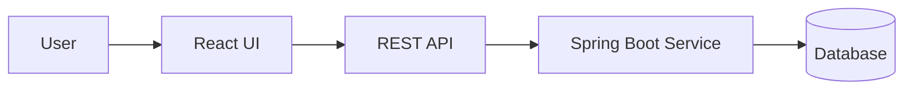

# [Project Name]

[One-paragraph summary explaining the business problem, intended users, and what this application demonstrates.]

## Overview

- **Project type:** [Learning / Intermediate / Advanced / Fintech Enterprise]
- **Frontend:** React [version], TypeScript, [Vite / other]
- **Backend:** [Spring Boot / Mock API / Not applicable]
- **Database:** [PostgreSQL / Oracle / Mock data / Not applicable]
- **Status:** [In progress / Completed / Learning implementation]

## Business Problem

Describe the business or user problem this project addresses. Use a realistic scenario and identify the primary users.

## Key Features

- [Feature 1]
- [Feature 2]
- [Feature 3]

## Architecture

Add an architecture diagram and explain the major components and request flow.



> Replace this example with the actual architecture. Remove components that are not implemented.

## Technology Stack

| Area | Technology | Purpose |
|---|---|---|
| UI | React | Component-based user interface |
| Language | TypeScript | Static typing |
| Build | Vite | Development server and build |
| API | [Fetch / Axios] | HTTP communication |
| Backend | [Spring Boot] | Business APIs |
| Testing | [Vitest / React Testing Library] | UI tests |

## Project Structure

```text
src/
├── app/
├── components/
├── features/
├── hooks/
├── services/
├── types/
└── main.tsx
```

Update this tree to match the actual implementation.

## Getting Started

### Prerequisites

- Node.js LTS
- npm
- [Java 21 and Maven, if a Spring Boot backend is included]

### Installation

```bash
npm install
```

### Run locally

```bash
npm run dev
```

### Build and quality checks

```bash
npm run build
npm run lint
```

Add backend startup instructions separately when applicable.

## Configuration

Document required environment variables using names and safe example values only.

```text
VITE_API_BASE_URL=http://localhost:8080/api
```

Never commit credentials, access tokens, private keys, or production connection strings.

## API Integration

| Method | Endpoint | Description |
|---|---|---|
| GET | `/api/example` | [Description] |
| POST | `/api/example` | [Description] |

Document request/response examples, validation rules, error responses, pagination, and authentication expectations when implemented.

## Screenshots

Add screenshots or short GIFs that show the key user journeys. Do not include real customer information or secrets.

## Testing

Describe:
- Unit and component tests
- API integration tests, if applicable
- Accessibility checks
- Manual test scenarios

## Security and Reliability Considerations

Document only controls that are actually implemented. Consider input validation, safe rendering, authorization boundaries, token handling, error handling, logging, and sensitive-data exposure.

## Limitations and Future Improvements

- [Known limitation]
- [Next improvement]

## Learning Outcomes

- [React concept learned]
- [TypeScript concept learned]
- [Architecture or integration concept learned]

## Author

**Ramu Boya**

- GitHub: https://github.com/Ramu-fsd
- LinkedIn: https://www.linkedin.com/in/ramuboya

## Disclaimer

This project is an educational portfolio implementation. Unless explicitly stated and demonstrated, sample data and simulated workflows are not connected to production banking systems and do not perform real financial transactions.
