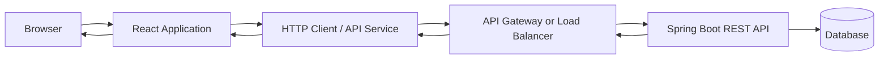

# React + Spring Boot Integration Guide

This guide describes the integration concerns to document and implement when a React frontend consumes Spring Boot REST APIs.

## High-level request flow



Adapt the diagram to the actual deployment. A small local application may call Spring Boot directly without an API gateway.

## Recommended frontend boundaries

- **Components:** render UI and capture user interaction.
- **Hooks:** coordinate reusable UI behavior and data loading.
- **Services:** own HTTP calls and endpoint-specific functions.
- **Types:** define request, response, and domain view types.
- **Features:** group code by business capability.

Example:

```text
src/
├── features/
│   └── customers/
│       ├── components/
│       ├── hooks/
│       ├── services/
│       └── types/
└── shared/
    └── api/
```

## API contract example

A Spring Boot endpoint might expose:

```http
GET /api/customers?page=0&size=20
```

Example response:

```json
{
  "content": [
    {
      "id": "C1001",
      "displayName": "Sample Customer",
      "status": "ACTIVE"
    }
  ],
  "number": 0,
  "size": 20,
  "totalElements": 1,
  "totalPages": 1
}
```

Corresponding TypeScript types:

```ts
export type CustomerStatus = "ACTIVE" | "INACTIVE";

export interface Customer {
  id: string;
  displayName: string;
  status: CustomerStatus;
}

export interface PageResponse<T> {
  content: T[];
  number: number;
  size: number;
  totalElements: number;
  totalPages: number;
}
```

Keep frontend contracts aligned with the backend's actual DTOs. Do not assume every Spring application uses this exact pagination shape.

## HTTP client example

```ts
const API_BASE_URL =
  import.meta.env.VITE_API_BASE_URL ?? "http://localhost:8080/api";

export async function getCustomers(): Promise<Customer[]> {
  const response = await fetch(`${API_BASE_URL}/customers`);

  if (!response.ok) {
    throw new Error(`Customer request failed: ${response.status}`);
  }

  return response.json() as Promise<Customer[]>;
}
```

For a real application, add typed error parsing, request cancellation where appropriate, and endpoint-specific functions. Avoid putting all API logic inside page components.

## Error handling

Agree on a consistent backend error contract. A useful error response can include:
- Timestamp
- HTTP status
- Stable application error code
- Safe user-facing message
- Field-level validation errors
- Correlation or trace identifier

The frontend should:
- Display actionable validation messages.
- Distinguish authentication, authorization, validation, not-found, rate-limit, and server failures.
- Avoid exposing stack traces or internal exception details.
- Preserve correlation IDs for support diagnostics when appropriate.

## CORS

During local development, the browser may call the frontend origin (for example, `http://localhost:5173`) and backend origin (for example, `http://localhost:8080`). Configure Spring Security / Spring MVC CORS policies for the intended origins, methods, and headers.

Do not use a wildcard origin with credentialed requests. Production CORS should allow only the required trusted origins.

## Authentication and security notes

- Authentication and authorization must be enforced by the backend.
- Hiding a button or route in React is not an authorization control.
- Prefer secure, appropriately configured server-managed sessions or a carefully designed OAuth2/OIDC flow.
- If tokens are used, document where they are stored, their lifetime, refresh behavior, and logout/revocation strategy.
- Avoid storing long-lived sensitive tokens in `localStorage` without a deliberate threat assessment.
- Use HTTPS outside local development.
- Never log credentials, access tokens, or sensitive customer data.

## Integration checklist

- [ ] API base URL is environment-configurable.
- [ ] DTOs and TypeScript types agree.
- [ ] Loading, empty, success, and error states are implemented.
- [ ] Validation errors are displayed clearly.
- [ ] Pagination and filtering semantics are documented.
- [ ] CORS is restricted to expected origins.
- [ ] Backend authorization is authoritative.
- [ ] Secrets are not committed.
- [ ] Tests cover API success and failure paths.
