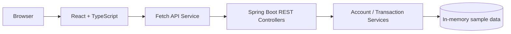

# Account & Transaction Management

A full-stack fintech learning application built with React 19, TypeScript, Java 21 and Spring Boot. It demonstrates account summaries, transaction history, filtering, server-side pagination and transaction detail retrieval through REST APIs.

**Author:** Ramu Boya  
**GitHub:** https://github.com/Ramu-fsd  
**LinkedIn:** https://www.linkedin.com/in/ramuboya

## Features

- Account summary cards with masked account numbers
- Account-specific transaction history
- Filter transactions by type and status
- Search by transaction reference or description
- Server-side pagination
- Transaction detail panel
- Typed frontend API service
- Spring Boot DTOs and REST controllers
- In-memory sample data

## Architecture



## Prerequisites

- Node.js LTS and npm
- Java 21
- Maven 3.9+

## Run backend

```bash
cd backend
mvn spring-boot:run
```

API base URL: `http://localhost:8081/api`

## Run frontend

In a separate terminal:

```bash
cd frontend
npm install
npm run dev
```

Open `http://localhost:5174`.

## API endpoints

| Method | Endpoint | Purpose |
|---|---|---|
| GET | `/api/accounts` | List accounts |
| GET | `/api/accounts/{accountId}` | Account details |
| GET | `/api/accounts/{accountId}/transactions?page=0&size=6&type=ALL&search=` | Filtered, paginated transactions |
| GET | `/api/transactions/{transactionId}` | Transaction details |

## Notes

All records are synthetic and stored in memory. Balances are illustrative and no real banking operations, transfers, settlement, or payment execution occur. Authentication and authorization are intentionally outside this learning baseline.

## Learning exercises

1. Add date-range filters.
2. Add transaction sorting by amount and booking date.
3. Add a downloadable CSV statement.
4. Replace in-memory data with PostgreSQL.
5. Add an authenticated API using Spring Security and an OAuth2/OIDC identity provider.
